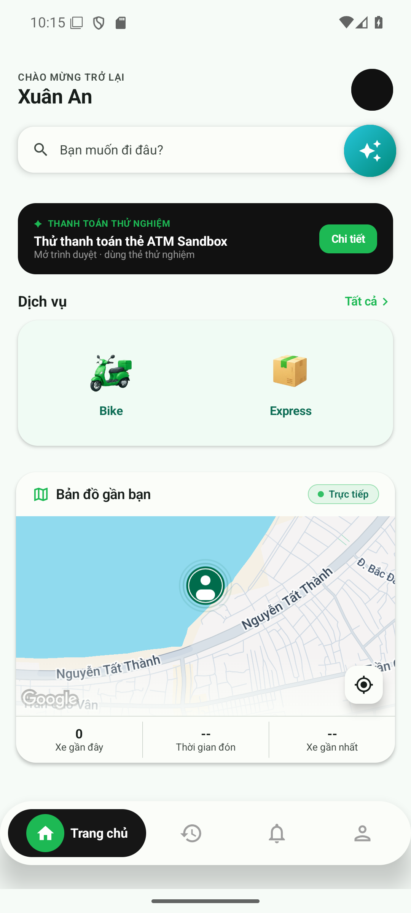
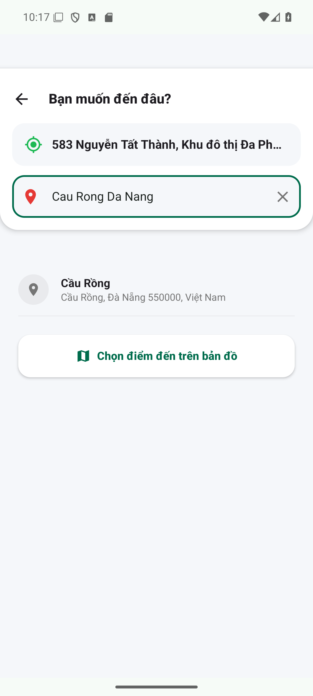
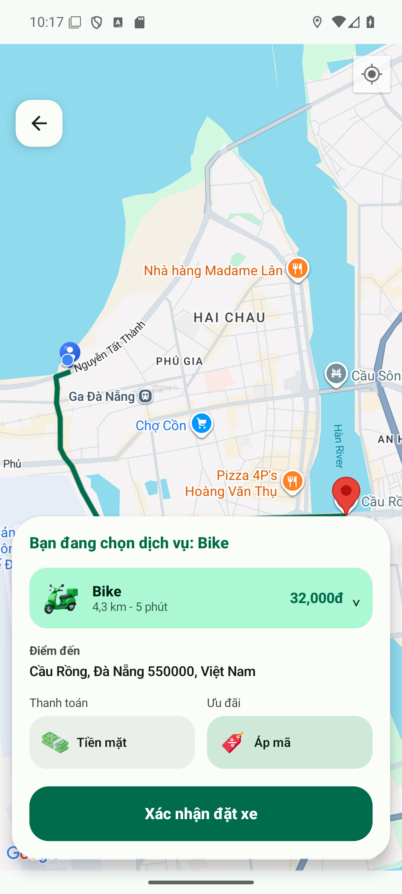
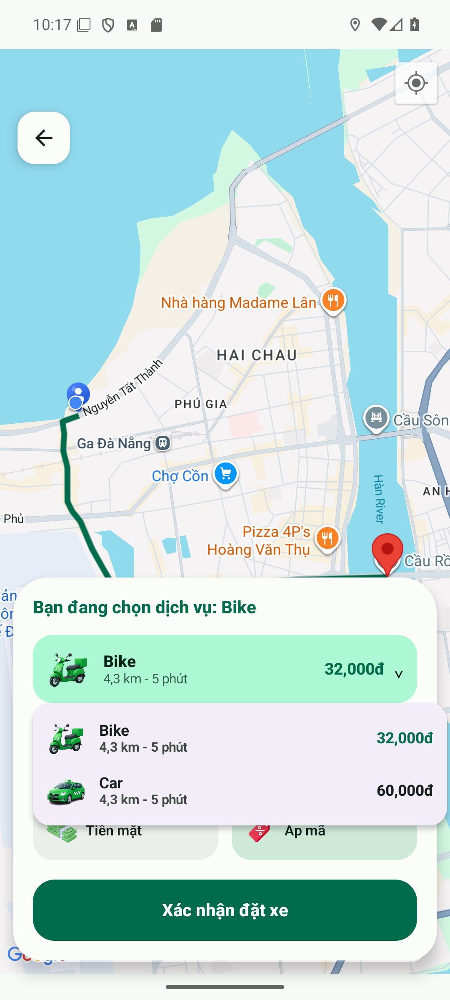
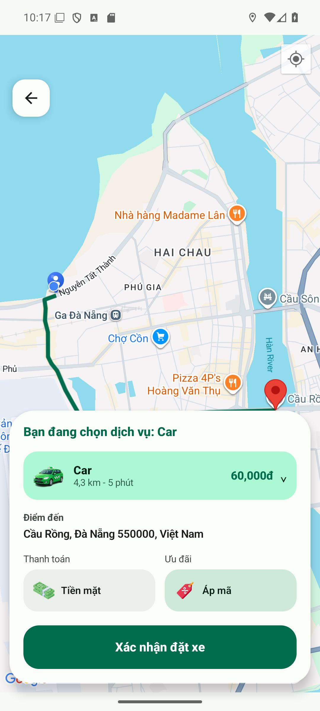
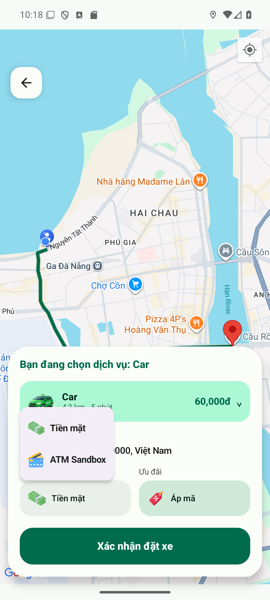
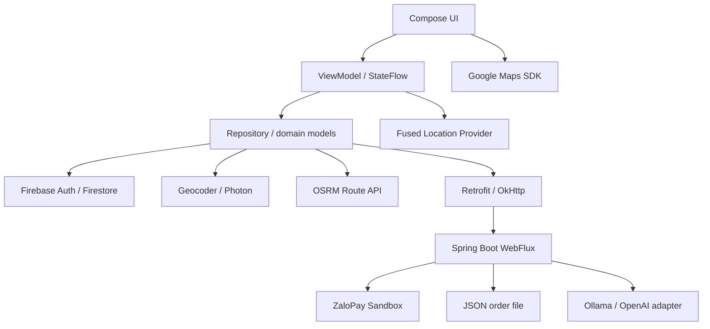

# WayWayApp

[Tiếng Việt](README.md) | [日本語](README.ja.md)

WayWayApp は、バイクや車を予約する Android アプリです。荷物を送る機能もあります。**Kotlin、Jetpack Compose、Firebase** を使っています。お客さん、運転手、管理者の画面があります。地図で場所を選び、道と予定の料金を見てから予約できます。

Spring Boot のバックエンドには、ZaloPay Sandbox の支払い機能と AI チャットがあります。

> 学習のために作ったプロジェクトです。この説明は、2026年10月29日のローカル版について書いています。まだ GitHub に入っていないコードもあります。ZaloPay は練習用の環境です。支払いが最後まで成功することは、まだ確認できていません。

## 主な機能

| 使う人       | できること                                                                                                                                    |
| ------------ | --------------------------------------------------------------------------------------------------------------------------------------------- |
| お客さん     | アカウント登録、ログイン、プロフィール、Bike/Car の予約、住所の検索、地図、予定の料金、クーポン、キャンセル、履歴、評価、運転手とのチャット。 |
| 荷物を送る人 | 出発地と届け先、受け取る人、荷物の情報を入力できます。Express は今、現金を使います。                                                          |
| 運転手       | 仕事の受付をオン・オフにする、位置を送る、近くの予約を受ける、状態を変える、チャット、履歴と収入を見る。                                      |
| 管理者       | ユーザー、運転手、予約、クーポンを管理する画面があります。                                                                                    |
| 支払い       | 現金、またはブラウザーで ZaloPay ATM Sandbox を使います。                                                                                     |
| AI           | バックエンドから Ollama を使えます。AI が使えない時は、デモの返事になることがあります。                                                       |

予約の主な状態は、次のように変わります。

```text
searching → accepted → arrived → in_progress → completed
```

キャンセルの状態もあります。運転手が予約を受ける時は、Firestore の transaction を使います。予約がまだ空いているか、運転手が3 km以内にいるかを確認します。自動で一番よい運転手を選ぶ機能ではありません。

## アプリの画面

下の写真は全部、**Android Emulator で動いているアプリのスクリーンショット**です。画面を作り直した写真ではありません。2026年10月29日に撮りました。場所は、Emulator でダナンに設定しました。地図、住所、道のデータはアプリのサービスから読み込みました。

|                                 ホームと地図                                 |                                     住所を探す                                     |                                    Bike の道と料金                                    |
| :--------------------------------------------------------------------------: | :--------------------------------------------------------------------------------: | :-----------------------------------------------------------------------------------: |
|  |  |  |

|                                  Bike / Car を選ぶ                                   |                                  Car の道と料金                                  |                                     支払いを選ぶ                                     |
| :----------------------------------------------------------------------------------: | :------------------------------------------------------------------------------: | :----------------------------------------------------------------------------------: |
|  |  |  |

デモでは、乗る場所を選んでから **Cầu Rồng（ロン橋）、Đà Nẵng（ダナン）** を探しました。OSRM の道を Google Maps に表示しました。この時は約 **4.3 km、5分、Bike は32,000 VND、Car は60,000 VND** でした。これはデモの計算による予定の料金です。本当のタクシー料金ではありません。写真は予約を確認する前の画面です。運転手が来たことや、乗車が終わったことを表す写真ではありません。

## 技術とサービス

| 技術・サービス                                   | 使い方                                                                                         |
| ------------------------------------------------ | ---------------------------------------------------------------------------------------------- |
| Kotlin / Jetpack Compose / Material 3            | Android の画面を作ります。                                                                     |
| Navigation Compose                               | 画面を移動します。                                                                             |
| ViewModel / StateFlow / Coroutines               | 画面のデータと、時間がかかる処理を管理します。                                                 |
| Firebase Authentication                          | ログインに使います。Google、Facebook、電話のログインには、それぞれ設定が必要です。             |
| Cloud Firestore                                  | ユーザー、予約、位置、チャット、クーポンを保存します。変更をリアルタイムで受け取ります。       |
| Firebase Cloud Messaging                         | Android 側で通知を受けるコードがあります。サーバーから送る全体の流れは、まだ確認していません。 |
| Google Maps SDK / Maps Compose                   | 地図、マーカー、カメラ、道の線を表示します。                                                   |
| Google Play Services Location                    | 許可をもらってから、端末の位置を使います。                                                     |
| OSRM Route API                                   | 道、距離、予定の時間を調べます。                                                               |
| Android Geocoder                                 | 住所の検索と、位置から住所を調べる時に使います。標準の設定です。                               |
| Photon / OpenStreetMap                           | 住所検索の別のサービスです。設定を変えると使えます。                                           |
| Nominatim / OpenStreetMap                        | 古い search/reverse API の定義が残っています。今の標準の住所検索では使っていません。           |
| Google Identity / Facebook Login SDK             | 外部アカウントでログインする時に使います。                                                     |
| ZaloPay Sandbox ATM                              | 練習用の支払いページをブラウザーで開きます。                                                   |
| Java 17 / Spring Boot 3.3 / WebFlux              | 支払いと AI の API を作っています。                                                            |
| Ollama / qwen2.5:1.5b / OpenAI adapter           | バックエンドから使う AI です。必要な時に設定します。                                           |
| Retrofit / OkHttp / Gson / Coil                  | API、JSON、画像の読み込みに使います。                                                          |
| Gradle / Maven / JUnit / Android instrumentation | ビルドとテストに使います。                                                                     |

Google Maps は地図を表示します。道を調べるのは **OSRM** です。この流れでは Google Directions API を使っていません。OSRM の設定は `driving` です。Bike にも使っていますが、バイク専用の道や、今の渋滞を表すものではありません。

住所の候補は、標準では **Android Geocoder** で探します。Google Places Autocomplete ではありません。`ADDRESS_SEARCH_PROVIDER=photon` にすると Photon を使います。Geocoder で失敗しても、自動で Photon に変わりません。

参考：[Google Maps SDK](https://developers.google.com/maps/documentation/android-sdk/get-api-key)、[Android Geocoder](https://developer.android.com/reference/android/location/Geocoder)、[OSRM](https://project-osrm.org/docs/v5.5.1/api/)、[Photon](https://github.com/komoot/photon)。

### 通信を減らす工夫

- 住所は3文字から探します。入力してから600 ms待つ debounce を使います。
- 古い検索を止め、古い結果で新しい画面が変わらないようにしています。
- 検索の結果をメモリーに64件まで、5分間保存します。新しい request の開始は1秒以上あけます。
- Firestore の変更を listener で受け取ります。必要がなくなった listener は外します。
- 運転手がオンラインの時は、約5秒ごとに位置を更新します。

速さが何％よくなったかは、まだ測っていません。

## アーキテクチャ

Android は **MVVM + Repository** です。画面は `presentation`、モデルは `domain`、データの処理は `data`、共通の設定は `core` に分けています。予約のデータは Android から Firebase を使います。Spring Boot は今、支払いと AI を担当しています。



```text
WayWayApp/
├── app/src/main/java/com/example/waywayapp/
│   ├── presentation/
│   ├── domain/
│   ├── data/
│   └── core/
├── firebase/firestore.rules
├── wayway-backend/
├── docs/screenshots/
└── gradlew.bat
```

### 支払いの流れ

1. アプリからバックエンドに、支払いの注文を作るように頼みます。
2. バックエンドは `key1` と HMAC-SHA256 を使い、ZaloPay に送ります。
3. アプリはブラウザーで ATM のページを開きます。
4. バックエンドは `key2` で callback を確認するか、query API で状態を調べます。ブラウザーから戻っただけでは `PAID` にしません。
5. アプリは、予約の情報と合う支払いか、まだ使っていない支払いかを確認します。

注文の時間は15分です。今は JSON ファイルで保存しています。デモの1つのサーバー向けです。本当のお金を使う前に、サーバー側でユーザー、予約、料金をもっと安全に確認する必要があります。

## Windows で動かす方法

### 1. 準備

Android Studio、SDK 36、Android 8/API 26以上の端末、または Google APIs/Play Services がある Emulator が必要です。Maven とインターネットも使います。確認した環境は JDK 21 です。バックエンドの Java release は17です。

```powershell
git clone https://github.com/XuanAnn/WayWayApp.git
cd WayWayApp
```

### 2. Android と Firebase の設定

自分の Firebase project を作り、`app/google-services.json` を置きます。package は `com.example.waywayapp` です。使うログイン方法と SHA/OAuth を設定してください。Firestore の database 名を設定に合わせます。rules は `firebase/firestore.rules` にあります。

ルートの `local.properties` に追加します。Android Studio の `sdk.dir` は残してください。

```properties
MAPS_API_KEY=YOUR_ANDROID_MAPS_KEY
BACKEND_BASE_URL=http://10.0.2.2:8081/
FIRESTORE_DATABASE_ID=waywayapp
ADDRESS_SEARCH_PROVIDER=android
PHOTON_BASE_URL=https://photon.komoot.io/
GOOGLE_WEB_CLIENT_ID=YOUR_WEB_OAUTH_CLIENT_ID
FACEBOOK_APP_ID=YOUR_FACEBOOK_APP_ID
FACEBOOK_CLIENT_TOKEN=YOUR_FACEBOOK_CLIENT_TOKEN
ADMIN_EMAILS=YOUR_TEST_ADMIN_EMAIL
```

使うサービスの情報を入れてください。Maps は SDK と billing を有効にし、package/SHA-1 で key を制限してください。`ADMIN_EMAILS` はアプリの設定で、安全な管理者権限の代わりではありません。支払いや AI の秘密の key を APK や Git に入れないでください。

- Emulator は `10.0.2.2` で PC に接続します。本当のスマートフォンは PC の LAN IP を使います。同じネットワークと firewall の設定が必要です。
- バックエンド URL の最後に `/` を付けます。標準の Firestore database を使う時は `(default)` にします。
- Photon を使う時は `ADDRESS_SEARCH_PROVIDER=photon` にします。Photon URL は HTTPS で、最後に `/` を付けます。
- 設定を変えたら、もう一度ビルドします。公開する時は HTTPS を使ってください。

### 3. バックエンド

ルートで実行します。

```powershell
mvn -f wayway-backend/pom.xml spring-boot:run
```

標準の port は **8081**、profile は **sandbox** です。自分の sandbox merchant を使う時は、起動前に設定します。

```powershell
$env:ZALOPAY_APP_ID='YOUR_SANDBOX_APP_ID'
$env:ZALOPAY_KEY1='YOUR_SANDBOX_KEY1'
$env:ZALOPAY_KEY2='YOUR_SANDBOX_KEY2'
```

callback/return を使う時は `ZALOPAY_CALLBACK_URL`、`ZALOPAY_RETURN_URL` に公開した HTTPS URL を設定します。ローカルで状態の query を試す時は、公開 callback がなくても使えます。

Ollama を使いたい時は、インストールしてから実行します。

```powershell
ollama pull qwen2.5:1.5b
ollama serve
```

すでに動いている時は `serve` をもう一度実行しません。標準の接続先は `localhost:11434` です。`demo` / `context` の返事は、AI モデルの返事とは違います。

### 4. Android を動かす

Android Studio でルートを開き、Gradle sync の後、`app` を実行します。APK を作る時は、次のコマンドを使います。

```powershell
.\gradlew.bat :app:assembleDebug
```

APK は `app/build/outputs/apk/debug/app-debug.apk` にあります。これは debug 版です。公開用には release の署名が必要です。

## できたこと

- お客さん、運転手、管理者の画面がある Android アプリを作りました。
- 住所を探し、OSRM の道を Google Maps に表示できました。ダナンのデモでは、距離、時間、Bike/Car の予定の料金を表示できました。
- ViewModel / StateFlow / Repository で、画面とデータの処理を分けました。debounce と cache で検索の request を減らす工夫をしました。
- Firestore の transaction、予約の状態、チャット、履歴、評価のコードを書きました。
- ZaloPay ATM Sandbox の注文とブラウザーの checkout をつなぎました。支払いが最後まで成功する流れは、まだ確認が必要です。
- 支払いと AI のバックエンドを作り、debug APK をビルドできました。Firebase の cloud を使っています。AWS へのバックエンド公開は、この作業では確認していません。

### これからの目標

住所を選んでから、運転手が予約を受け、チャットをし、乗車が終わるまで、同じアプリで使えるようにします。Sandbox の支払いを最後まで確認し、サーバーの権限とデータを安全にしてから公開します。

テストの詳しい情報は [技術メモ（ベトナム語）](docs/README_VERIFICATION.md) に分けています。

### 開発用の確認コマンド

```powershell
mvn -f wayway-backend/pom.xml test
.\gradlew.bat :app:testDebugUnitTest :app:assembleDebug
```

Windows の Java で `Unable to establish loopback connection` が出る時は、短い一時フォルダーを使って、もう一度試してください。

```powershell
New-Item -ItemType Directory -Force build/java-tmp | Out-Null
$javaTempDirectory = (Resolve-Path build/java-tmp).Path
$env:JAVA_TOOL_OPTIONS="-Djdk.net.unixdomain.tmpdir=$javaTempDirectory"
```

## これから直すところ

- `PAID` までの支払い、返金、料金とユーザーの確認を完成させます。
- Firestore rules と管理者の権限を強くします。
- 支払いの保存を JSON から database に変えます。
- 複数の端末と、多くのアクセスで確認します。速さも測ります。
- 公開用の routing/search サービス、通知を送るサーバー、release APK、HTTPS、監視とバックアップを準備します。

ソースコード：[XuanAnn/WayWayApp](https://github.com/XuanAnn/WayWayApp)。
