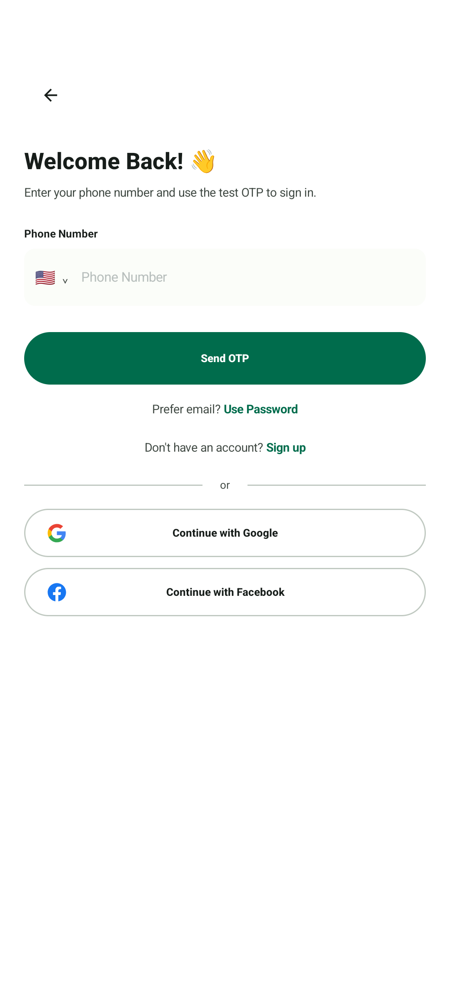
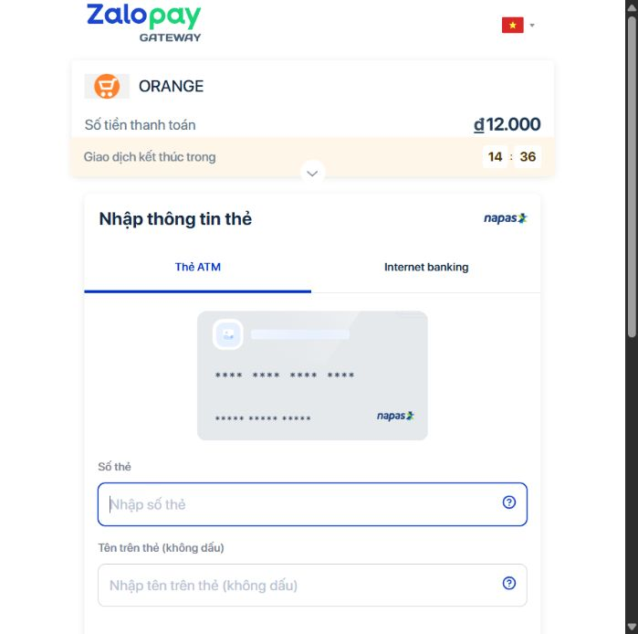
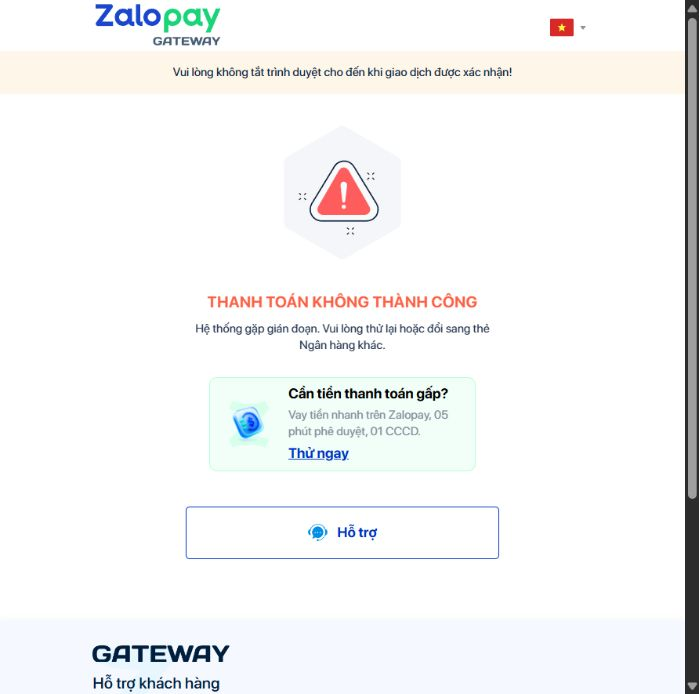
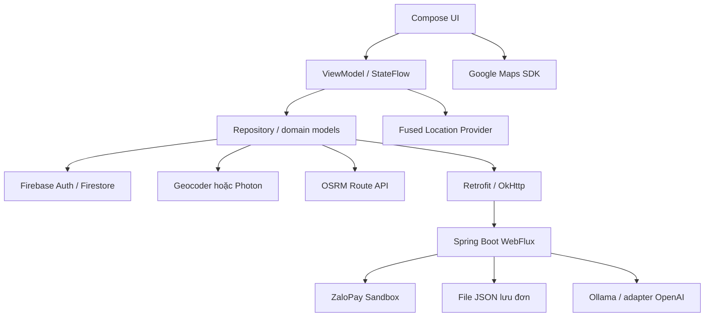

# WayWayApp

Ứng dụng Android đặt xe và giao hàng bằng **Kotlin, Jetpack Compose và Firebase**, có giao diện cho khách hàng, tài xế và quản trị viên. Người dùng chọn điểm đón/đến, xem tuyến và giá dự kiến, đặt xe, theo dõi trạng thái và chat với tài xế. Backend Spring Boot phụ trách thanh toán ZaloPay sandbox và trợ lý AI.

> Tài liệu mô tả bản local được kiểm tra ngày **29/10/2026**. Một số phần triển khai/test còn chưa commit, nên GitHub có thể chưa có đầy đủ mã tương ứng. Đây là dự án học tập; thanh toán thử nghiệm chưa xác nhận `PAID` xuyên suốt với cổng sandbox.

## Chức năng

| Vai trò       | Chức năng có trong mã nguồn                                                                                                                                |
| ------------- | ---------------------------------------------------------------------------------------------------------------------------------------------------------- |
| Khách hàng    | Đăng ký/đăng nhập, hồ sơ, đặt Bike/Car, chọn địa chỉ hoặc điểm trên bản đồ, xem tuyến và giá, mã giảm giá, hủy chuyến, lịch sử, đánh giá, chat với tài xế. |
| Giao hàng     | Chọn điểm nhận/giao, thông tin người nhận và kiện hàng; Express hiện dùng tiền mặt.                                                                        |
| Tài xế        | Bật/tắt nhận chuyến, cập nhật vị trí, nhận chuyến gần mình, cập nhật trạng thái, chat, lịch sử và tổng hợp thu nhập.                                       |
| Quản trị viên | Các màn hình quản lý người dùng, tài xế, chuyến đi và mã giảm giá.                                                                                         |
| Thanh toán    | Tiền mặt hoặc ATM ZaloPay sandbox trên trình duyệt; tạo đơn, xác minh callback và truy vấn trạng thái.                                                     |
| Trợ lý        | API chat dùng Ollama, trả lời theo ngữ cảnh hoặc chế độ demo khi mô hình không khả dụng.                                                                   |

Trạng thái chính: `searching → accepted → arrived → in_progress → completed`, có nhánh `cancelled`. Nhận chuyến dùng transaction Firestore để kiểm tra chuyến còn trống và tài xế trong phạm vi 3 km, hạn chế nhận trùng; chưa phải thuật toán tự động chọn tài xế tối ưu.

## Ảnh màn hình

Ảnh lấy từ artifact chạy thử, không phải thiết kế minh họa. Hai ảnh Android là màn hình thật mở qua bộ kiểm thử giao diện; ảnh cổng thanh toán lấy từ lần thử sandbox trước đó.

|                                  Đăng nhập                                   |                                  Chọn thanh toán                                   |
| :--------------------------------------------------------------------------: | :--------------------------------------------------------------------------------: |
|  |  |

|                                       Form ATM sandbox                                        |                                                    Kết quả thử cổng                                                     |
| :-------------------------------------------------------------------------------------------: | :---------------------------------------------------------------------------------------------------------------------: |
|  |  |

Lần thử đã mở form và tới OTP giả lập nhưng cổng báo gián đoạn hệ thống. Ảnh cuối **không phải** bằng chứng thanh toán thành công.

## Công nghệ và dịch vụ

| Công nghệ/dịch vụ                                           | Vai trò trong dự án                                                                                         |
| ----------------------------------------------------------- | ----------------------------------------------------------------------------------------------------------- |
| Kotlin, Jetpack Compose, Material 3, Navigation Compose     | UI Android và điều hướng ba vai trò.                                                                        |
| ViewModel, StateFlow, Coroutines                            | MVVM, trạng thái UI và xử lý bất đồng bộ.                                                                   |
| Firebase Authentication                                     | Xác thực email/mật khẩu; các đường Google/Facebook/điện thoại cần cấu hình provider tương ứng.              |
| Cloud Firestore                                             | Lưu hồ sơ, chuyến, vị trí, chat, mã giảm giá; đồng bộ bằng snapshot listener và transaction nhận chuyến.    |
| Firebase Cloud Messaging                                    | Thành phần nhận thông báo Android; chưa xác minh đầy đủ hệ thống gửi push phía server.                      |
| Google Maps SDK for Android, Maps Compose                   | Nền bản đồ, camera, marker đón/đến/tài xế và polyline.                                                      |
| Google Play Services Location / FusedLocationProviderClient | Lấy vị trí thiết bị sau khi được cấp quyền, hỗ trợ cập nhật vị trí tài xế.                                  |
| OSRM Route API                                              | Khoảng cách, thời gian và hình học tuyến qua `/route/v1/driving/...`; dùng để vẽ tuyến và tính giá dự kiến. |
| Android Geocoder                                            | Provider tìm/gợi ý địa chỉ mặc định và reverse geocoding; kết quả phụ thuộc thiết bị và mạng.               |
| Photon / OpenStreetMap                                      | Provider autocomplete tùy chọn qua HTTP, bật bằng `ADDRESS_SEARCH_PROVIDER=photon`.                         |
| Nominatim / OpenStreetMap                                   | Còn định nghĩa API search/reverse cũ; không phải provider autocomplete mặc định.                            |
| Google Identity / Credential Manager, Facebook Login SDK    | Các phương thức đăng nhập ngoài khi được cấu hình.                                                          |
| ZaloPay Sandbox ATM                                         | Checkout bằng trình duyệt, tạo đơn, callback và query trạng thái; không yêu cầu cài ví để mở luồng ATM.     |
| Java 17, Spring Boot 3.3, WebFlux, Reactor, WebClient       | API thanh toán/AI và giao tiếp dịch vụ ngoài.                                                               |
| Ollama, mặc định `qwen2.5:1.5b`; adapter OpenAI             | Trợ lý tùy chọn phía backend; giữ khóa AI phía server.                                                      |
| Retrofit, OkHttp, Gson, Coil                                | HTTP, JSON và tải ảnh Android.                                                                              |
| Gradle, Maven, JUnit, Android instrumentation               | Build và kiểm thử logic, API, UI.                                                                           |

**Google Maps chỉ hiển thị bản đồ; OSRM cung cấp tuyến.** Dự án không dùng Google Directions API cho luồng này. OSRM hiện dùng profile `driving`, kể cả Bike, chưa bảo đảm tuyến chuyên biệt cho xe máy hay dữ liệu giao thông trực tiếp.

**Autocomplete hiện không dùng Google Places Autocomplete.** Mặc định là Android Geocoder; Photon được chọn bằng cấu hình, không tự động gọi thay khi Geocoder lỗi. Endpoint Photon/OSRM công cộng phục vụ demo không có cam kết độ sẵn sàng.

Tham khảo: [Google Maps SDK](https://developers.google.com/maps/documentation/android-sdk/get-api-key), [Android Geocoder](https://developer.android.com/reference/android/location/Geocoder), [OSRM](https://project-osrm.org/docs/v5.5.1/api/), [Photon](https://github.com/komoot/photon).

### Giảm request và xử lý kết quả cũ

- Tìm địa chỉ từ 3 ký tự, debounce 600 ms; hủy tác vụ cũ và kiểm tra phiên tìm kiếm trước khi cập nhật UI.
- Cache trong bộ nhớ tối đa 64 truy vấn, TTL 5 phút; giãn thời điểm bắt đầu request tối thiểu 1 giây trong tiến trình.
- Tính tuyến bỏ qua phản hồi lỗi thời khi địa chỉ thay đổi.
- Firestore dùng listener và gỡ listener khi ngừng thu thập Flow; vị trí tài xế cập nhật khoảng 5 giây khi online.

Đây là cơ chế có trong mã nguồn; chưa có benchmark để công bố tỷ lệ cải thiện hiệu suất.

## Kiến trúc

Android theo MVVM và repository, tách `presentation`, `domain`, `data`, `core`. Dữ liệu chuyến đi được Android thao tác trực tiếp qua Firebase; Spring Boot hiện tập trung vào thanh toán và AI, chưa phải backend xử lý toàn bộ đặt xe.



```text
WayWayApp/
├── app/src/main/java/com/example/waywayapp/
│   ├── presentation/   # Compose, ViewModel, điều hướng
│   ├── domain/         # Model và quy tắc ứng dụng
│   ├── data/           # Repository, API, DTO
│   └── core/           # Mạng và thành phần dùng chung
├── firebase/firestore.rules
├── wayway-backend/     # Thanh toán và AI
├── docs/screenshots/
└── gradlew.bat
```

### Thanh toán hoạt động thế nào?

1. Android chốt điểm đón/đến, dịch vụ và số tiền rồi yêu cầu backend tạo đơn.
2. Backend ký HMAC-SHA256 bằng `key1`, nhận URL và cho ứng dụng mở checkout trên trình duyệt.
3. Khi quay lại, ứng dụng kiểm tra trạng thái; backend xác minh callback bằng `key2` hoặc gọi query có chữ ký và đối chiếu thông tin giao dịch.
4. Redirect/deep link không tự đánh dấu đã thanh toán. Android chỉ dùng kết quả hợp lệ, chưa dùng và khớp thông tin đặt xe để tiếp tục tạo chuyến trả trước.

Đơn có thời hạn 15 phút. Callback lặp, query khôi phục trạng thái và dữ liệu sai có test tự động. Backend hiện lưu đơn bằng file JSON cho demo một instance; cần ràng buộc giá, người dùng và chuyến bằng backend đáng tin cậy trước khi thu tiền thật.

## Cách chạy trên Windows

### 1. Chuẩn bị

Cần Android Studio, SDK 36, thiết bị Android 8/API 26 trở lên hoặc emulator có Google APIs/Play Services; Maven và Internet. Môi trường kiểm tra dùng JDK 21, backend biên dịch Java release 17. Gradle wrapper có sẵn.

```powershell
git clone https://github.com/XuanAnn/WayWayApp.git
cd WayWayApp
```

### 2. Cấu hình Android

Dùng Firebase project của bạn, đặt `google-services.json` tại `app/`, đúng package `com.example.waywayapp`. Bật provider đăng nhập cần dùng và cấu hình SHA/OAuth tương ứng. Tạo Firestore database khớp cấu hình; xem xét `firebase/firestore.rules` trước khi deploy.

Bổ sung vào `local.properties` ở thư mục gốc; giữ dòng `sdk.dir` Android Studio đã tạo:

```properties
MAPS_API_KEY=YOUR_ANDROID_MAPS_KEY
BACKEND_BASE_URL=http://10.0.2.2:8081/
FIRESTORE_DATABASE_ID=waywayapp
ADDRESS_SEARCH_PROVIDER=android
PHOTON_BASE_URL=https://photon.komoot.io/
GOOGLE_WEB_CLIENT_ID=YOUR_WEB_OAUTH_CLIENT_ID
FACEBOOK_APP_ID=YOUR_FACEBOOK_APP_ID
FACEBOOK_CLIENT_TOKEN=YOUR_FACEBOOK_CLIENT_TOKEN
ADMIN_EMAILS=YOUR_TEST_ADMIN_EMAIL
```

Chỉ điền provider bạn sử dụng. Maps cần bật Google Maps SDK, billing và hạn chế key theo package/SHA-1. `ADMIN_EMAILS` là cấu hình client, không thay thế phân quyền an toàn. Không đưa khóa thanh toán/AI vào APK hoặc Git.

- Emulator dùng `10.0.2.2`; điện thoại thật dùng IP LAN của máy backend, cùng mạng và cho phép cổng 8081 qua firewall.
- URL backend phải có `/` cuối. Dùng `FIRESTORE_DATABASE_ID=(default)` nếu chọn database mặc định.
- Muốn thử Photon, đặt `ADDRESS_SEARCH_PROVIDER=photon`; endpoint phải HTTPS và có `/` cuối.
- Build lại sau khi đổi cấu hình. HTTP hiện phục vụ local; bản phát hành cần HTTPS và cấu hình mạng phù hợp.

### 3. Backend

Tại thư mục gốc:

```powershell
mvn -f wayway-backend/pom.xml spring-boot:run
```

Mặc định cổng **8081**, profile **sandbox**. Nếu dùng merchant sandbox riêng, đặt biến trước khi chạy:

```powershell
$env:ZALOPAY_APP_ID='YOUR_SANDBOX_APP_ID'
$env:ZALOPAY_KEY1='YOUR_SANDBOX_KEY1'
$env:ZALOPAY_KEY2='YOUR_SANDBOX_KEY2'
```

`ZALOPAY_CALLBACK_URL` và `ZALOPAY_RETURN_URL` dùng HTTPS công khai nếu cấu hình nhận callback/return. Có thể thử query local mà không public callback. Không dùng thông tin sandbox để thu tiền thật.

AI tùy chọn, nếu đã cài Ollama:

```powershell
ollama pull qwen2.5:1.5b
ollama serve
```

Không chạy thêm `serve` nếu dịch vụ đã chạy nền. Backend mặc định gọi `localhost:11434`. Phản hồi chế độ `demo`/`context` không chứng minh mô hình AI đã chạy.

### 4. Chạy app hoặc build APK

Mở thư mục gốc trong Android Studio, chờ sync và chạy module `app`, hoặc:

```powershell
.\gradlew.bat :app:assembleDebug
```

APK tại `app/build/outputs/apk/debug/app-debug.apk`. Đây là APK debug để thử; bản phân phối chính thức cần ký release.

## Kiểm thử và kết quả

```powershell
mvn -f wayway-backend/pom.xml test
.\gradlew.bat :app:testDebugUnitTest :app:assembleDebug
```

| Hạng mục                               | Kết quả                                                                                              |
| -------------------------------------- | ---------------------------------------------------------------------------------------------------- |
| Backend, chạy lại 29/10/2026           | **62 test đạt**, không lỗi/thất bại; gồm API, AI, ZaloPay và MoMo cũ.                                |
| Android unit test, chạy lại 29/10/2026 | **19 test đạt**, không lỗi/thất bại.                                                                 |
| Android debug build, 29/10/2026        | **Thành công**.                                                                                      |
| Instrumentation                        | Báo cáo trước ghi nhận 8 test đạt; đợt README chưa chạy lại vì không có thiết bị ADB kết nối.        |
| Cổng ATM sandbox                       | Tạo đơn, query `WAITING`, mở form và tới OTP giả lập; chưa đạt `PAID` do lần thử cổng báo gián đoạn. |
| Cloud                                  | Tích hợp Firebase; chưa xác minh triển khai backend WayWayApp lên AWS/cloud riêng trong đợt này.     |

Test mock xác minh logic chữ ký, callback lặp, lỗi và trạng thái, không thay thế thanh toán thực tế. Xem [phạm vi xác minh](docs/README_VERIFICATION.md).

Nếu Java trên Windows báo `Unable to establish loopback connection`, thử thư mục tạm ngắn trước khi chạy lại:

```powershell
New-Item -ItemType Directory -Force build/java-tmp | Out-Null
$javaTempDirectory = (Resolve-Path build/java-tmp).Path
$env:JAVA_TOOL_OPTIONS="-Djdk.net.unixdomain.tmpdir=$javaTempDirectory"
```

## Hướng hoàn thiện

- Xác nhận `PAID` toàn luồng, đối soát/hoàn tiền và kiểm tra giá, chủ đơn, chuyến ở backend trước thanh toán thật.
- Siết Firestore rules và quyền quản trị; client còn tham gia ghi nhiều trường nghiệp vụ nhạy cảm.
- Thay file đơn JSON bằng cơ sở dữ liệu phù hợp nhiều instance.
- Kiểm thử khách–tài xế trên nhiều máy, kiểm thử tải và đo hiệu suất thực tế.
- Chọn dịch vụ routing/search có độ sẵn sàng phù hợp thay cho endpoint demo.
- Hoàn thiện push phía server, release ký số, HTTPS, giám sát và sao lưu backend.

Mã nguồn: [XuanAnn/WayWayApp](https://github.com/XuanAnn/WayWayApp).
